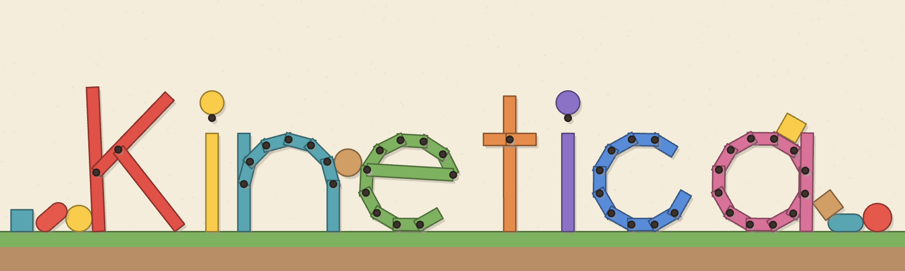

<p align="center">
  
</p>

<p align="center">
  A lightweight, deterministic 2D physics engine for games, written in Rust.<br>
  <b><a href="https://chiroyupy.github.io/Kinetica/">Try it in your browser</a></b>
  · <a href="docs/ARCHITECTURE.md">Architecture</a>
  · <a href="docs/ROADMAP.md">Roadmap</a>
</p>

---

The picture above is made by the engine: every letter is a handful of bars welded together, and
the shapes around it were dropped on the ground.

## Try it

Nothing to install: the **[testbed](https://chiroyupy.github.io/Kinetica/testbed/)** runs in the
browser. It has 45 scenes, one idea each, from body types to joints and queries; grab bodies,
launch balls or blast them away. The [five games](https://chiroyupy.github.io/Kinetica/) built on
the engine run there too.

## What it does

- **Bodies and shapes**: fixed, kinematic and dynamic bodies; circles, convex polygons, capsules,
  segments and one-sided chains for levels.
- **Joints**: revolute, prismatic, weld, distance, wheel and mouse joints, with limits, motors,
  springs, and forces to break them under load.
- **Stable stacking**: a substepped soft-step solver, with sleeping and continuous collision, so
  fast bullets do not go through walls.
- **Game features**: sensors, one-way platforms, collision layers, contact events with impact
  speed, ray casts, shape casts and overlap queries.
- **Deterministic**: the same build gives the same simulation, and `World` is `Clone`, so
  snapshots and rollbacks are cheap. An optional `serde` feature saves worlds.
- **Plain Rust**: no `unsafe`, no rendering dependency, a handle-based API.

```rust
use kinetica::prelude::*;

let mut world = World::new();
world.add_body(BodyDesc::fixed().collider(ColliderDesc::rectangle(20.0, 1.0)));
let ball = world.add_body(
    BodyDesc::dynamic().position(vec2(0.0, 10.0)).collider(ColliderDesc::circle(0.5).restitution(0.5)),
);

for _ in 0..60 {
    world.step(1.0 / 60.0);
}
println!("The ball is at {}", world[ball].position());
```

Sizes are full sizes (`rectangle(20.0, 1.0)` is 20 m wide), joint anchors are world points, and
indexing the world with a handle reaches the body, collider or joint.

## Run it locally

```sh
cargo run --release -p kinetica-testbed       # interactive testbed
cargo run --release -p slingshot              # or trials, platformer, snip, fruits
cargo run --release -p kinetica-bench         # performance benchmarks
cargo test --workspace --all-features         # all tests
```

## Workspace

| Crate | Role |
|-------|------|
| [`crates/kinetica`](crates/kinetica) | The engine. No rendering or windowing dependency. Optional `serde` feature. |
| [`crates/kinetica-collision`](crates/kinetica-collision) | The geometry under the engine, usable alone: shapes, contact points between two shapes, a bounding box tree. |
| [`crates/kinetica-macroquad`](crates/kinetica-macroquad) | Glue for macroquad games: camera in meters, debug rendering, a cut-paper look for games, fixed time step, mouse grab. |
| [`crates/kinetica-bench`](crates/kinetica-bench) | Reproducible performance benchmarks, with the time of each step stage. |
| [`crates/kinetica-testbed`](crates/kinetica-testbed) | One labeled scene per engine concept, from body types to queries. |
| [`games/slingshot`](games/slingshot) | Knock down towers of wood, glass and stone with a slingshot. |
| [`games/trials`](games/trials) | Drive a little car over hills, a plank bridge, a seesaw and a jump to the flag. |
| [`games/platformer`](games/platformer) | Run and jump across one-way and moving platforms, push a box, collect coins. |
| [`games/snip`](games/snip) | Cut the ropes to drop the sweet in the basket. |
| [`games/fruits`](games/fruits) | Drop fruits in a jar; two alike merge into a bigger one. |

## The website

The site is built with `scripts/build-site.sh` (it needs `rustup target add wasm32-unknown-unknown`)
and published by a GitHub Actions workflow on every push to `main`.
`scripts/build-web.sh <crate>` builds a single game or the testbed for the browser:

```sh
scripts/build-web.sh slingshot Slingshot      # output in target/web/slingshot
python3 -m http.server -d target/web/slingshot 8000
```
